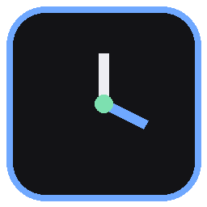

# 时间显示器 (Time Display)

一个常驻桌面最上层的多功能时间显示器 —— **时钟 / 定时 / 秒表** 三合一。

安静、无边框、不弹警告、不闪烁。就一块玻璃面板贴在屏幕角落，不打断你正在做的事。



```
┌──────────────────────────┐
│   时钟   定时   秒表      │   ← 点这里切换模式
│                          │
│        21:47:03          │   ← Consolas 等宽，跳秒不晃
│    2026年02月14日 周六     │
│  双击隐藏 · Tab 切换       │
└──────────────────────────┘
```

## 三种模式

| 模式 | 显示 | 用途 |
|---|---|---|
| **时钟** | `21:47:03` + 日期星期 | 日常看时间 |
| **定时** | `24:59.8` 倒计时 | 番茄钟、护眼、说好"再玩半小时" |
| **秒表** | `3:07.42` 正计时，支持计次 | 计时、测时长、记录每一局 |

## 快捷键

| 按键 | 作用 |
|---|---|
| 点击顶部模式名 / `Tab` | 切换模式 |
| `空格` | 定时、秒表：开始 / 暂停 |
| `R` / `Esc` | 复位 |
| `L` | 秒表：计次（会显示与上一次的差值） |
| `↑` `↓` | 定时：±1 分钟（`Shift` 为 ±5 分钟） |
| 双击面板 | 临时隐藏 / 显示 |
| `Ctrl+Alt+A` | **全局**：循环切换模式 |
| `Ctrl+Alt+S` | **全局**：开始 / 暂停 |
| `Ctrl+Alt+R` | **全局**：复位 |

全局热键走 Win32 `RegisterHotKey`，所以在**别的窗口（包括游戏）里也能按**。

## 运行

需要 Python 3.8+（只用标准库，`tkinter` 随 Python 自带，**无第三方依赖**）。

```bash
python app.py                          # 时钟模式，默认贴屏幕右上角
python app.py --mode timer --minutes 25
python app.py --mode stopwatch
python app.py --probe                  # 自检：写出 _probe.txt
```

Windows 上双击 `启动时间显示器.bat` 可以无黑窗启动。

## 配置

全部在 [`config.py`](config.py) 里，改完重启生效：

```python
BG = "#131316"        # 面板背景
FG = "#EDEDF2"        # 时钟数字
FG_TIMER = "#FFB454"  # 定时数字
TIMER_MINUTES = 25    # 默认倒计时长度
X = None              # None = 自动贴右；也可以写 X = 1450, Y = 40 钉死位置
SOUND = True          # 到点响铃
TTS = False           # 到点用系统语音念一句
```

## 关于"置顶看不见"这件事

程序用了三层手段让自己待在最上层：Tk 的 `-topmost`、Win32 `SetWindowPos(HWND_TOPMOST)`、以及每 12 秒一次的"摘掉 topmost 再戴回去"强制重绘。

**但是**：如果某个程序跑在 **独占全屏（exclusive fullscreen）** 下，它会直接接管显示输出、绕过桌面合成器，这时**任何**普通置顶窗口都画不出来 —— 这是 Windows 的机制，不是本程序的 bug。

用 `--probe` 可以一眼判断：

```bash
python app.py --probe && type _probe.txt
```

```
设置底色=#131316
屏幕实际像素:
  (+3,+3) = (39, 41, 48)      ← ≈ 边框色，说明真的显示出来了
  (+14,+14) = (39, 41, 48)
```

如果这里读出的是游戏画面而不是窗口自己的颜色，就说明被绕过了。解决办法：把那个程序改成**窗口化 / 无边框窗口**（多数游戏 `Alt+Enter` 或设置里的"显示模式"）。想让它在全屏游戏里也能显示，只能走 DirectX 挂钩的覆盖层（RTSS 那类），不属于本项目的范围。

顺带一提，如果你机器上装着录屏/串流软件（OBS、采集卡工具等），它们自身的顶层窗口有时也会插在最上面，可以先用 `--probe` 确认排除。

## 技术说明

- **纯标准库**：`tkinter` + `ctypes`（调 Win32 API），没有任何 pip 依赖
- **无边框窗口**：`overrideredirect(True)` + 自适应内容尺寸
- **计时用 `time.monotonic()`**：不受系统时间调整影响，秒表不会漂
- **`WS_EX_TOOLWINDOW`**：不占任务栏、不出现在 Alt+Tab 里
- **等宽字体**：秒数跳动时数字宽度不变，面板不会左右抖
- **全局热键在独立线程**：`PeekMessageW` 轮询消息队列，不阻塞 Tk 主循环

已知限制：全局热键若被别的软件占用会静默失效（换 `config.py` 里的组合键即可）；多显示器下只按主屏尺寸定位。

## 文件

```
app.py        主程序（三种模式 + 界面 + 热键）
config.py     配置：配色、字体、位置、默认时长
utils.py      Win32 小工具：置顶、图标、全局热键、提示音、语音
icon.ico      图标
启动时间显示器.bat   无黑窗启动（Windows）
```

## 许可

MIT，见 [LICENSE](LICENSE)。
